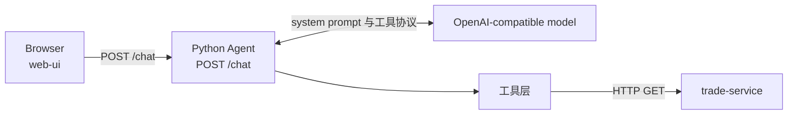

# Trade Assistant

一个本地可运行的订单查询助手。浏览器里的对话只发给 Python Agent；Agent 按问题选择工具，再由工具调用 Java 服务里的内存订单数据。

当前能问的是订单状态、商品和金额，交易流程，以及支付账户。业务数据是写在代码里的 Mock，没有数据库，也没有登录。

## 组成

| 目录 | 作用 | 入口 |
| --- | --- | --- |
| `web-ui` | React + Vite + TypeScript 对话页面 | `src/main.tsx` |
| `python-agent` | FastAPI + LangChain Agent | `app/main.py` |
| `trade-service` | Spring Boot 订单查询 API | `TradeServiceApplication` |

更细的调用关系见 [docs/architecture.md](docs/architecture.md)。

## 技术栈

版本以仓库里的声明为准。

| 部分 | 来源 | 版本 |
| --- | --- | --- |
| Java | `trade-service/pom.xml` 的 `java.version` | 17 |
| Spring Boot | 同上，parent | 3.4.5 |
| Python 依赖 | `python-agent/requirements.txt` | FastAPI 0.141.1、Uvicorn 0.54.0、Pydantic 2.13.5、LangChain 1.4.2、langchain-core 1.6.5、langchain-openai 1.6.6、LangGraph 1.2.12、httpx 0.28.1 |
| 前端声明 | `web-ui/package.json` | React `^19.3.1`、Vite `^8.3.4`、TypeScript `~6.0.3`、Vitest `^5.0.5` |
| 前端锁定 | `web-ui/package-lock.json` | React 19.3.1、react-dom 19.3.1、Vite 8.3.4、TypeScript 6.0.3、Vitest 5.0.5、jsdom 30.1.3 |

仓库没有 `pyproject.toml` 或 `python_requires`。改写前的 `python-agent/README.md` 写的是 Python 3.11 及以上。本次写文档没有另装解释器验证这个下限。

## 架构



工具有三个，选择依据写在 `python-agent/app/agent.py` 的 system prompt 和各工具的英文说明里，由模型决定调用哪一个或哪几个：

| 用户在问 | 工具 | Java 接口 |
| --- | --- | --- |
| 状态、商品、金额 | `get_order` | `GET /api/orders/{orderId}` |
| 交易步骤、支付、发货、送达时间线 | `get_trade_flow` | `GET /api/orders/{orderId}/trade-flow` |
| 支付账户、付款人、渠道、掩码账号 | `get_trade_account` | `GET /api/orders/{orderId}/trade-account` |

没有订单号时，prompt 要求模型先追问，而不是编造订单号。这是提示词约束。仓库里的行为测试使用脚本化模型替身，不能当作真实模型已经遵守该提示的证据。

## 本地启动

开三个终端，先启动 Java，再启动 Agent，最后启动页面。Agent 导入时就会读取配置；没有 `OPENAI_API_KEY` 时进程起不来。

### 1. trade-service，端口 8080

端口来自 `trade-service/src/main/resources/application.properties` 的 `server.port=8080`。

```bash
cd trade-service
mvn spring-boot:run
```

### 2. python-agent，端口 8000

`python-agent/README.md` 的启动命令显式使用 `--port 8000`。前端默认也访问这个地址。`.vscode/launch.json` 里的 Python 调试配置没有写端口。

```bash
cd python-agent
python3 -m venv venv
source venv/bin/activate
pip install -r requirements.txt
cp .env.example .env
uvicorn app.main:app --reload --port 8000
```

把 `.env` 里的 `OPENAI_API_KEY` 换成可用密钥。不要把真实密钥提交到 Git。`.env` 已被根目录 `.gitignore` 忽略。

交互文档：<http://127.0.0.1:8000/docs>

### 3. web-ui

`vite.config.ts` 没有改 `server.port`。Agent 的 CORS 只允许这两个页面来源：

- `http://localhost:5173`
- `http://127.0.0.1:5173`

```bash
cd web-ui
npm install
npm run dev
```

页面标题是「订单助手」。快捷提问会发送这三句完整问题：

- `订单 ORD-1001 的金额是多少？`
- `ORD-1001 的交易流程怎么样？为什么还没送达？`
- `ORD-1001 的支付渠道是什么？`

## 环境变量

只列出名称和代码中的默认值。示例文件里的密钥是占位符 `sk-your-key-here`。

| 变量 | 读取位置 | 代码默认值 |
| --- | --- | --- |
| `OPENAI_API_KEY` | `python-agent/app/config.py` | 无，必填 |
| `OPENAI_BASE_URL` | 同上 | `https://api.deepseek.com` |
| `OPENAI_MODEL` | 同上 | `deepseek-v4-flash` |
| `TRADE_SERVICE_BASE_URL` | 同上 | `http://localhost:8080` |
| `VITE_API_BASE_URL` | `web-ui/src/config.ts` | `http://127.0.0.1:8000` |

`VITE_API_BASE_URL` 在 Vite 构建或开发服务器启动时注入。改完需要重新启动 `npm run dev`。Java 服务没有额外的环境变量，端口写在 `application.properties`。

## 测试

仓库里现有的都是隔离测试：Java 用 MockMvc，Python 用 `unittest` 和替身，前端用 Vitest。没有真实模型评测，也没有同时拉起浏览器、Agent、Java 和真实模型的端到端测试。命令和分类见 [docs/testing.md](docs/testing.md)。

```bash
cd trade-service && mvn test
cd python-agent && source venv/bin/activate && python -m unittest discover -s tests -t .
cd web-ui && npm test
cd web-ui && npm run build
```

## 已知限制

- 订单、流程和支付账户都是内存 Mock，只有 `ORD-1001` 和 `ORD-1002`。
- Java 按订单号原样查找。大小写和 `ORD-` 前缀的整理只发生在 Python 工具里。
- 侧栏里除「对话」以外的导航是禁用按钮。搜索框没有查询逻辑。
- 对话只留在页面状态里，刷新后消失。
- 没有登录、下单、支付、数据库、Redis、消息队列或 Docker 配置。
- `get_order` 会区分超时、连接失败、HTTP 非 200 和非法 JSON。`get_trade_flow` 与 `get_trade_account` 仍把这些失败收成同一句 `Trade service is unavailable.`

## 文档

- [架构](docs/architecture.md)
- [测试](docs/testing.md)
- [演示](docs/demo.md)
- [尚未实现的部分](docs/roadmap.md)
