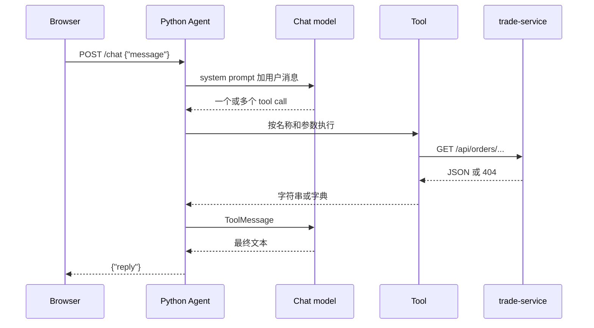

# 架构

Trade Assistant 是三条独立进程：页面、Python Agent、Java API。页面不调用 Java，也不保存订单数据。

## 调用链



模型可以在一次响应里给出多个 tool call，也可以在看到工具结果后再请求下一个工具。`python-agent/tests/test_agent_behavior.py` 用替身分别走了这两种协议。真实模型会选哪一种，当前测试没有覆盖。

## 页面

`web-ui/src/api/chat.ts` 的 `sendChat` 只做一件事：向 `${VITE_API_BASE_URL}/chat` 发送 `POST`，请求体是 `{ "message": "..." }`。

- 网络失败时提示「无法连接订单助手，请确认服务已启动。」
- HTTP 非 2xx 时提示「订单助手暂时无法回答，请稍后再试。」页面不展示响应正文。
- 成功响应必须是带字符串 `reply` 的 JSON。

`App.tsx` 在发送前会 `trim()`。空消息不会发出。Enter 发送，Shift+Enter 换行。请求进行中不能再次提交。失败后可以用「重新发送」把同一句原文再发一次。

CORS 在 `python-agent/app/main.py`。允许的来源只有 `http://localhost:5173` 和 `http://127.0.0.1:5173`，方法是 `GET` 和 `POST`，请求头是 `Content-Type`。

## Agent

`app/main.py` 提供：

| 方法 | 路径 | 成功响应 |
| --- | --- | --- |
| `GET` | `/health` | `{"status":"ok"}` |
| `POST` | `/chat` | `{"reply":"..."}` |

`ChatRequest.message` 至少 1 个字符，并且去掉空白后不能为空。只含空格、制表符或换行符返回 422，处理函数不会调用 `run_agent`。带内容的消息保持原样，包括首尾空格。

Agent 执行抛错时返回 HTTP 500，正文固定为：

```json
{"detail":"订单助手暂时无法回答，请稍后再试。"}
```

日志只记录异常类型，不记录异常文本。

`app/agent.py` 用 LangChain `create_agent` 注册三个工具。system prompt 原文是：

> You are an order assistant. If no order id is given, ask for one. Answer in the user's language, using only the tool result. You may call one or more tools when necessary: 1. order status, item, or amount → get_order 2. trade steps, payment/shipping/delivery timeline → get_trade_flow 3. payment account, payer, channel, or account number → get_trade_account

模型客户端是 `ChatOpenAI`，读取 `OPENAI_MODEL`、`OPENAI_API_KEY` 和 `OPENAI_BASE_URL`。图在导入模块时创建一次。`run_agent` 同步调用 `graph.invoke`，取最后一条消息的文本，并在标准输出打印用户消息、工具名、参数、工具结果和最终回答。

## 工具层

三个工具都在 `python-agent/app/tools.py`。订单号先去掉首尾空白、转成大写，没有 `ORD-` 前缀时补上。因此模型传入 `ord-1001` 或 `1001` 时，请求 URL 里的订单号是 `ORD-1001`。Java 不做这层整理。

工具使用 `httpx.get`，超时 5 秒，并使用 httpx 的默认代理行为。

| 工具 | 成功时交给模型的结果 |
| --- | --- |
| `get_order` | 字符串 `order_id=... , status=... , item=... , amount=...` |
| `get_trade_flow` | `order_id`、`found`、`current_status`、`steps` 的字典。Java 的 camelCase 在这里改成 snake_case |
| `get_trade_account` | `order_id`、`found`、`account_id`、`account_name`、`payment_channel`、`masked_account_no`、`currency` 的字典 |

Java 返回 404 时，正文是 `{"status":404,"message":"Order not found: ORD-9999"}`。工具不把这份错误 JSON 当成订单、流程或账户：

- `get_order` 返回 `Order ORD-9999 was not found.`
- `get_trade_flow` 返回 `found: false`、`current_status: "not_found"`、空步骤
- `get_trade_account` 返回 `found: false`，其余账户字段为空

`get_order` 的其他失败文案：

- 超时：`Trade service timed out.`
- 连接失败：`Trade service is unavailable.`
- 其他 HTTP 状态：`Trade service returned HTTP {status}.`
- JSON 无法解析、不是对象，或 `orderId`、`status`、`item`、`amount` 任一缺失或不是字符串：`Trade service returned an invalid order response.`

这些字符串是给模型看的失败说明，不是订单字段。

## Java API

`OrderController` 挂在 `/api/orders`。`OrderService` 从三个内存 Repository 读取，找不到就抛 `OrderNotFoundException`。`RestExceptionHandler` 把它转成 HTTP 404 和 `ErrorResponse(status, message)`。

成功响应的 JSON 字段来自 Java record，因此是 camelCase：

```json
{
  "orderId": "ORD-1001",
  "status": "shipped",
  "item": "Mechanical Keyboard",
  "amount": "599.00"
}
```

流程步骤字段是 `step`、`name`、`status`、`occurredAt`。`occurredAt` 可以是 `null`。支付账户字段是 `orderId`、`found`、`accountId`、`accountName`、`paymentChannel`、`maskedAccountNo`、`currency`。

内存数据定义在：

- `repository/OrderRepository.java`
- `repository/TradeFlowRepository.java`
- `repository/TradeAccountRepository.java`

| 订单号 | 订单 | 流程当前状态 | 支付渠道 |
| --- | --- | --- | --- |
| `ORD-1001` | shipped，Mechanical Keyboard，599.00 | shipped。created、paid、shipped 为 done；delivered 为 pending，`occurredAt` 为 null | alipay，账户 `ACC-8801`，掩码 `138****1001`，CNY |
| `ORD-1002` | pending，USB-C Cable，29.00 | pending。只有 created 为 done，时间是 `2026-09-26 14:00:00` | wechat_pay，账户 `ACC-8802`，掩码 `138****1002`，CNY |

两笔支付账户的 `accountName` 在源码里都是 `Logan Zhang`。这是 Mock 字段，不是从环境或外部系统读出来的。

除这三组 GET 接口和 404 处理外，Java 工程没有其他控制器。
